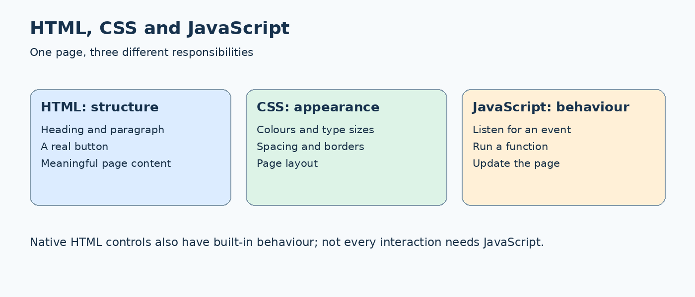
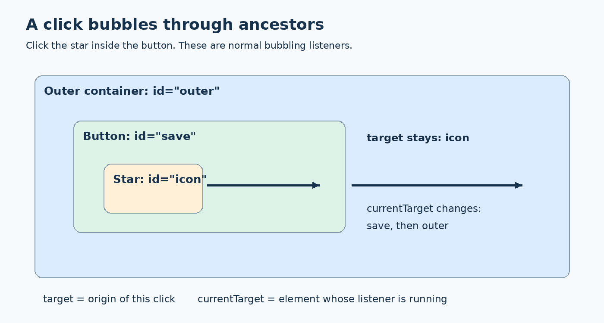
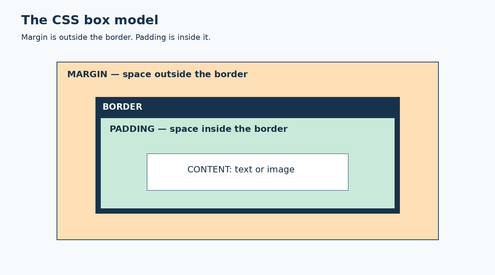
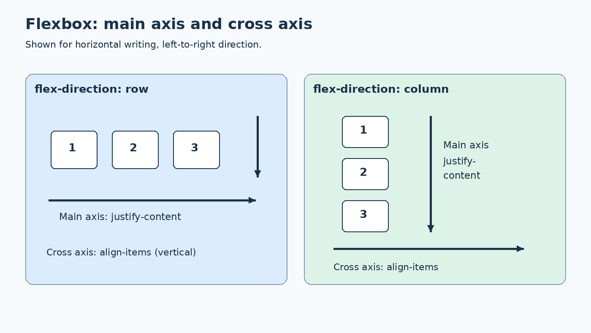
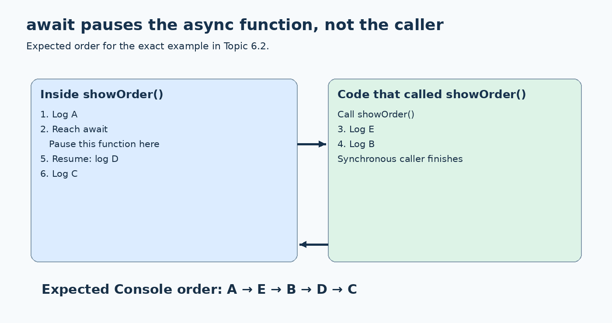
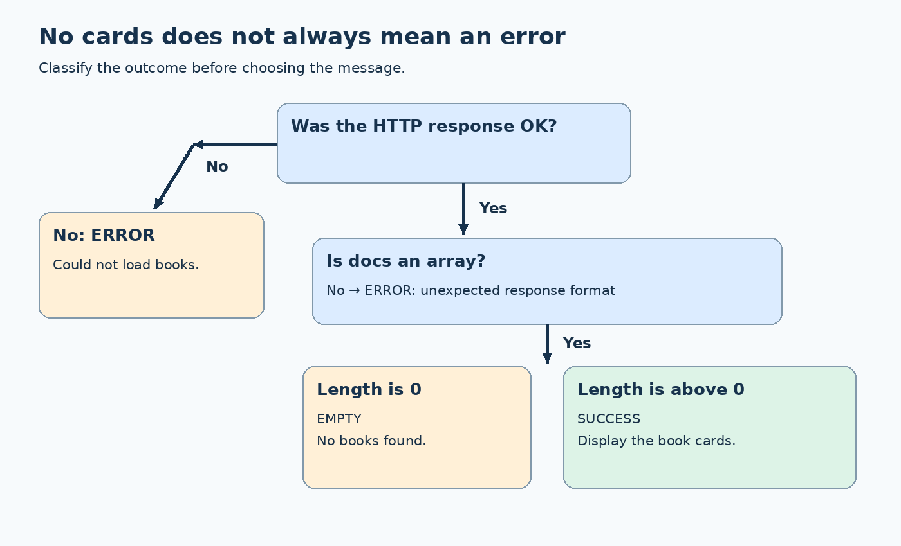

# Front-End Research Study Guide

A beginner-friendly front-end development study guide covering HTML, CSS, JavaScript, DOM events, responsive layouts and API-related data handling. Includes step-by-step model solutions for 24 research topics, runnable examples, explanatory diagrams and self-check questions.

Start with **understanding**, not memorising: predict what will happen, run a small example, observe the result, and explain why.

## What this guide is — and is not

- Covers all 24 proposed research topics across Lessons 1–6.
- Provides model answers, complete local HTML examples, expected results, diagrams and self-check questions.
- Assumes no prior HTML, CSS, JavaScript, terminal or Git experience.
- Uses the uploaded briefs to define the scope. The examples are newly authored replacements because the starter folders mentioned in the briefs were not included.
- Does not claim these examples were tested in a browser or that their expected results are recorded student findings. Run them yourself to collect evidence.
- Diagrams are explanatory illustrations, not browser screenshots or pixel-perfect page previews.
- Is a study aid, not an additional assessment requirement. Follow your lecturer’s instructions where they differ.

<a id="disclaimer"></a>
## Disclaimer

> This repository is an educational companion to the provided research briefs, not an official answer key or assessment rubric. Its model solutions and examples illustrate possible approaches; other valid solutions may exist. Follow your lecturer’s instructions and assessment requirements.
>
> The materials were prepared with AI assistance and may contain errors or omissions. Expected outputs are provided for comparison, not as evidence of completed browser testing. Students should run the examples, verify important claims against reliable documentation, and explain their own observations.
>
> Examples are simplified for learning and are not production-ready. They do not demonstrate every security, accessibility, validation or error-handling requirement. Use fictional or public data only; do not enter personal information, passwords, API keys or confidential material into shared examples or AI tools.
>
> PNG diagrams are conceptual illustrations, not browser screenshots. External documentation may change over time. Acknowledge sources and AI assistance according to your institution’s academic integrity requirements.

<a id="repository-description"></a>
## GitHub repository description

Beginner-friendly front-end study guide with 24 worked topics, runnable HTML examples, PNG diagrams and self-check questions.

<a id="included-resources"></a>
## Included resources

| Resource | Description |
|---|---|
| Study guide | Read explanations, follow worked solutions and check your understanding at your own pace. |
| Runnable examples | Open small, independent HTML examples locally and change one thing at a time to investigate behaviour. |
| PNG diagrams | Use visual explanations to understand page responsibilities, spacing, layout axes, event propagation and asynchronous flow. |
| Self-check questions | Test whether you can explain the concept before consulting the answer hints. |
| Troubleshooting guide | Identify common beginner mistakes and understand why an example behaves unexpectedly. |
| Research-sharing template | Organise your question, prediction, evidence, conclusion and limitations into a clear explanation. |

The example files and PNG diagrams are distributed in the companion study pack. Keep its `examples` and `assets` folders alongside this README; this Markdown file alone does not contain those files.

## Contents

- [Disclaimer](#disclaimer)
- [Repository description](#repository-description)
- [Included resources](#included-resources)
- [Start here](#start-here)
- [The research habit](#the-research-habit)
- [Beginner vocabulary](#beginner-vocabulary)
- [Lesson 1: Foundations](#lesson-1)
- [Lesson 2: Functions and data](#lesson-2)
- [Lesson 3: DOM and events](#lesson-3)
- [Lesson 4: HTML, forms and CSS](#lesson-4)
- [Lesson 5: Responsive layouts](#lesson-5)
- [Lesson 6: JSON and asynchronous code](#lesson-6)
- [Self-check answer hints](#self-check-answer-hints)
- [Troubleshooting](#troubleshooting)
- [Sharing your research](#sharing-your-research)
- [Original brief mapping](#original-brief-mapping)

<a id="start-here"></a>
## Start here

### 1. Unzip the complete study pack

Keep the folder structure unchanged:

```text
front-end-research-study-guide/
├── README.md                 ← this study guide
├── assets/                   ← six PNG diagrams used by this README
└── examples/
    ├── index.html            ← open this first
    ├── 1-1-....html           ← standalone topic example
    ├── ...                   ← 24 topic examples in total
    └── 3-1-defer/
        ├── index.html        ← additional external-script example
        └── app.js
```

The README uses relative image and file links. They work when the folders stay together, including when uploaded together to a GitHub repository. A README copied on its own will not include its diagrams.

### 2. Open the example index

1. Open the `examples` folder in your file manager.
2. Double-click `index.html` to open it in a modern browser, such as Chrome, Edge or Firefox.
3. Select the topic you want to study.
4. Return using the example’s “Back to example index” link.

All bundled examples use local data. You do not need an API key, package installation, terminal, web server or live API. The external documentation links need internet access.

### 3. Open the browser Console

The Console is a panel that shows messages from `console.log()` and JavaScript errors.

1. Right-click the example page and select Inspect. Menu wording varies by browser.
2. Select the Console tab in Developer Tools.
3. Clear old messages if necessary.
4. Reload the page to run its script again.
5. Read the messages from top to bottom.

Do not be surprised if arrays initially appear collapsed: expand them to see the entries. Use the Elements/Inspector panel to inspect HTML and applied CSS. Some browsers show the accessibility tree in a separate panel.

### 4. Edit a file safely

1. Make a copy of the example before experimenting.
2. Open the HTML file in a plain-text editor, such as Visual Studio Code.
3. Change only one thing.
4. Save the file.
5. Return to the browser and reload.
6. Compare the result with your prediction.

Do not edit code in a word processor. Make sure the file ends in `.html`, not `.html.txt`. Changes made only in DevTools are usually temporary and disappear on reload.

### 5. Know where each language belongs

A complete HTML page has this general shape:

```html
<!doctype html>
<html lang="en">
<head>
  <meta charset="utf-8">
  <meta name="viewport" content="width=device-width, initial-scale=1">
  <title>My study example</title>
  <style>
    /* CSS goes here. */
  </style>
</head>
<body>
  <h1>My study example</h1>
  <p>Visible HTML content goes here.</p>

  <script>
    // JavaScript goes here, after the content in this example.
    console.log("The page has loaded.");
  </script>
</body>
</html>
```

Each topic below separates relevant HTML, CSS and JavaScript for easier reading. The linked example already combines them into a complete file. You do not need to assemble the snippets yourself. Topic 3.1 deliberately includes an early inline script to demonstrate a timing problem.

### Optional: put the pack on GitHub

Git is a version-control tool; GitHub is a service that can host a repository. Neither is required to study this pack.

To publish using GitHub’s website, create or open a repository, use Add file → Upload files, add the README and the two folders while preserving their structure, and commit the upload. GitHub renders the Markdown README and its relative PNG links. It does not run the example HTML as a live page in the repository viewer: download/open it locally, or configure GitHub Pages separately.

<a id="the-research-habit"></a>
## The research habit

For each topic:

1. Question: What are we trying to find out?
2. Predict: What do we think will happen, and why?
3. Check: Read the relevant documentation and run the example.
4. Observe: Write what actually happened, including error messages.
5. Explain: Connect the observation to the concept.
6. Limit: State what the small example does not establish.

An observation is something you directly saw: “the Console displayed null”. An inference is your interpretation: “the script probably ran before the form existed”. Check the source order to test that interpretation.

Do not treat matching AI answers as independent evidence. Check documentation and source links, acknowledge AI use, and never enter personal or confidential information into an AI tool. Deliberately broken code is useful only when you can explain the failure.

For Lessons 1–2, the original briefs make coding optional. Lessons 3–6 ask for a small working example. In Lesson 6, the suggested 25-minute split is 10 minutes investigating, 10 minutes preparing the example and 5 minutes preparing to share.

<a id="beginner-vocabulary"></a>
## Beginner vocabulary

| Term | Plain-language meaning |
|---|---|
| HTML element | A piece of page structure, such as a paragraph or button. |
| Attribute | Extra information in a start tag, such as `id="save"`. |
| CSS selector | A pattern for choosing which elements a rule targets. |
| Declaration | A CSS property/value pair, such as `color: blue`. |
| Variable | A named binding that lets code refer to a value. |
| String | Text, usually written in quotation marks. |
| Number | A numeric value, such as `18`, rather than the text `"18"`. |
| Boolean | The value `true` or `false`. |
| Array | An ordered collection; its first index is `0`. |
| Object | A collection of named properties, such as `title`. |
| Function | Reusable code that can accept inputs and return an output. |
| Parameter / argument | A parameter names an input in a function definition; an argument is the actual value supplied when calling it. |
| Callback | A function supplied to other code to call at the appropriate time. |
| DOM | The browser’s object representation of the document. |
| Event | A notification that something happened, such as a click or input edit. |
| `null` | A deliberately empty or absent value; a selector returns it when no element matches. |
| `undefined` | A value commonly encountered when a property or indexed entry is absent. |
| JSON | A text format used to exchange structured data. |
| API | An interface through which software requests or exchanges information. |
| Promise | An object representing an eventual result or failure. |
| Viewport | The area in which the browser displays the page. |
| CSS pixel | The layout unit used in these width examples, not necessarily one physical screen pixel. |

### Read the common symbols

| Code | Meaning in these examples |
|---|---|
| `=` | Assign a value. |
| `===` | Compare values without type coercion. |
| `.` | Access a named property, as in `activity.title`. |
| `[0]` | Access the first array entry. |
| `()` | Call a function, or enclose its parameters. |
| `=>` | Define an arrow function. |
| `!value` | Negate a truthy/falsy condition. |
| `condition ? a : b` | Choose `a` when the condition is true, otherwise `b`. |
| `value || fallback` | Use the fallback if the value is falsy, including an empty string. |
| `value ?? fallback` | Use the fallback only for `null` or `undefined`. |
| `item?.title` | Access the property safely when item might be null or undefined. |
| Backticks and `${value}` | Build a template string containing an expression’s value. |
| `//` | A JavaScript single-line comment. |
| `/* ... */` | A CSS or JavaScript comment. |

Official background: [MDN JavaScript Guide](https://developer.mozilla.org/en-US/docs/Web/JavaScript/Guide).

---
<a id="lesson-1"></a>
## Lesson 1: Foundations of front-end development

Understand the roles of HTML, CSS and JavaScript, compare basic programming concepts, explore usability and practise checking online claims.

Scope source: `FED_L01_Group_Research_Student-1.docx`.



<a id="topic-1-1"></a>
### 1.1 HTML, CSS and JavaScript

#### Model answer

HTML gives content its structure; CSS changes presentation; JavaScript implements programmed behaviour. Native HTML controls also provide built-in behaviour.

[Open the complete example](examples/1-1-html-css-and-javascript.html) — locally, open it from the example index.

#### Step by step

1. Open the example and select Join activity.
2. Comment out the activity-card and button CSS below, save and reload.
3. Restore the CSS. Comment out the event listener, save and reload.
4. Compare content, appearance and the custom message.

#### Code to study

HTML inside the example’s body:

```html
<article class="activity-card">
  <h2>Robotics Workshop</h2>
  <p>Build a simple robot.</p>
  <button id="join" type="button">Join activity</button>
  <p id="message" aria-live="polite"></p>
</article>
```

CSS inside the example’s `<style>` element:

```css
.activity-card { max-width: 25rem; padding: 1rem; border: 1px solid #999; border-radius: 0.5rem; }
#join { padding: 0.6rem 1rem; background: navy; color: white; }
```

JavaScript inside the example’s final `<script>` element:

```javascript
const button = document.querySelector("#join");
const message = document.querySelector("#message");
button.addEventListener("click", () => {
  message.textContent = "You have selected this activity.";
});
```

#### Expected result

With everything enabled, the message appears. Without the example CSS, content stays but the card loses its custom styling. Without the listener, this button does not show the message.

#### Conclusion you can explain

> HTML supplies this content, CSS styles it, and JavaScript adds this custom response.

#### Check your understanding

Why is “all interaction requires JavaScript” too broad?

#### Important detail / limitation

A native form can submit without JavaScript. This example deliberately uses type="button" to isolate custom behaviour.

<a id="topic-1-2"></a>
### 1.2 From Python to JavaScript

#### Model answer

Functions, parameters and return values express similar ideas in both languages. Syntax and type behaviour still need checking.

[Open the complete example](examples/1-2-from-python-to-javascript.html) — locally, open it from the example index.

#### Step by step

1. Read the Python comparison below.
2. Predict the JavaScript outputs before opening the Console.
3. Run the example and inspect typeof enteredAge.
4. Change enteredAge to "20" and predict again.

#### Code to study

HTML inside the example’s body:

```html
<p>Open the Console to see the results.</p>
```

JavaScript inside the example’s final `<script>` element:

```javascript
function hasSpace(booked, capacity) {
  return booked < capacity;
}
console.log(hasSpace(8, 10));
const enteredAge = "18";
console.log(typeof enteredAge);
console.log(enteredAge + 1);
console.log(Number(enteredAge) + 1);
console.log(enteredAge === 18);
```

#### Expected result

The Console shows true, string, 181, 19, false, in that order.

#### Conclusion you can explain

> The concept transfers, but numeric text must be converted before numeric addition.

#### Check your understanding

What does Number("18") change: the original variable, or the value used in that expression?

#### Important detail / limitation

Python comparison:
```python
def has_space(booked, capacity):
    return booked < capacity

print(has_space(8, 10))  # True
```
JavaScript uses braces for this function body; Python uses indentation. A blank string becomes 0 with Number(), so conversion is not sufficient validation.

<a id="topic-1-3"></a>
### 1.3 Make a page easier to use

#### Model answer

Use clear wording, meaningful grouping and a specific action label. Treat usability improvements as proposals to test, not guaranteed results.

[Open the complete example](examples/1-3-make-a-page-easier-to-use.html) — locally, open it from the example index.

#### Step by step

1. Ask a classmate to identify the activity, time and action in each version.
2. Record hesitation and questions without coaching them.
3. Compare findings; use different or counterbalanced examples if repeating the task.
4. Separate what you saw from what you inferred.

#### Code to study

HTML inside the example’s body:

```html
<section>
  <h2>Before</h2>
  <div>Robotics</div><div>Friday 3 pm</div>
  <button type="button">Click here</button>
</section>
<section>
  <h2>Proposed improvement</h2>
  <article class="activity-card">
    <h3>Robotics Workshop</h3>
    <p>Friday, 3:00 pm · Engineering Lab</p>
    <p>Suitable for beginners. Equipment provided.</p>
    <button type="button">Join Robotics Workshop</button>
  </article>
</section>
```

CSS inside the example’s `<style>` element:

```css
.activity-card { max-width: 28rem; border: 1px solid #888; padding: 1rem; } section { margin-bottom: 2rem; }
```

#### Expected result

The second version explicitly names the action and groups the details. Whether users perform better must be observed, not assumed.

#### Conclusion you can explain

> Our proposal reduces ambiguity; our user observations determine how strongly we can support it.

#### Check your understanding

Which part of your explanation is observation, and which part is inference?

#### Important detail / limitation

These buttons demonstrate wording only; neither registers a user. A small classroom comparison is not evidence that every user benefits by the same amount.

<a id="topic-1-4"></a>
### 1.4 Check an online or AI claim

#### Model answer

The claim “the CSS rule written last always wins” is incomplete. Specificity can defeat a later rule when earlier cascade criteria are equal.

[Open the complete example](examples/1-4-check-an-online-or-ai-claim.html) — locally, open it from the example index.

#### Step by step

1. Predict whether the paragraph will be red or blue.
2. Run the page and inspect the paragraph in DevTools.
3. Reverse the two CSS rules.
4. Explain why the class selector still wins.

#### Code to study

HTML inside the example’s body:

```html
<p class="notice">Predict my colour before opening the page.</p>
```

CSS inside the example’s `<style>` element:

```css
.notice { color: red; }
p { color: blue; }
```

#### Expected result

The paragraph is red in both orders because .notice is more specific than p.

#### Conclusion you can explain

> We checked an overly broad claim with documentation and a small counterexample.

#### Check your understanding

Why is agreement between two AI answers not independent verification?

#### Important detail / limitation

This example assumes normal author declarations in the same cascade layer, with no other competing styles. Importance, origin and layers are considered before specificity.

### Documentation for this lesson

- [MDN: Structuring content with HTML](https://developer.mozilla.org/en-US/docs/Learn_web_development/Core/Structuring_content)
- [MDN: Introduction to events](https://developer.mozilla.org/en-US/docs/Learn_web_development/Core/Scripting/Events)
- [MDN: Specificity](https://developer.mozilla.org/en-US/docs/Web/CSS/Guides/Cascade/Specificity)

---
<a id="lesson-2"></a>
## Lesson 2: Functions and data modelling

Learn how scope, parameters, return values, arrays, objects, filter(), map() and const support reusable JavaScript code.

Scope source: `FED_L02_Group_Research_Student.docx`.

<a id="topic-2-1"></a>
### 2.1 Scope parameters and return

#### Model answer

A function can read its parameters and enclosing variables. Its local variables are not directly available to the caller. Explicit inputs make dependencies easier to see.

[Open the complete example](examples/2-1-scope-parameters-and-return.html) — locally, open it from the example index.

#### Step by step

1. Run the example and identify each input.
2. Uncomment only the console.log(subtotal) line and reload.
3. Observe the ReferenceError. Comment the line again.
4. Change the fee argument to 0 and calculate the result before running.

#### Code to study

HTML inside the example’s body:

```html
<p>Open the Console. The intentional error is commented out in the source.</p>
```

JavaScript inside the example’s final `<script>` element:

```javascript
function totalPrice(ticketPrice, quantity, fee) {
  const subtotal = ticketPrice * quantity;
  return subtotal + fee;
}
console.log(totalPrice(10, 3, 2));
console.log(totalPrice(10, 3, 0));
// Uncomment to investigate scope, then comment it again:
// console.log(subtotal);
```

#### Expected result

The working calls log 32 and 30. Reading subtotal outside the function produces ReferenceError when that test is enabled.

#### Conclusion you can explain

> Parameters expose inputs and return exposes the result; local variables stay inside their scope.

#### Check your understanding

Why does console.log inside a function not replace return?

#### Important detail / limitation

Reading outer variables is legal and useful in many designs. The point is to understand the dependency, not to ban closures or shared state.

<a id="topic-2-2"></a>
### 2.2 Organise activity data

#### Model answer

Use an array for the collection and one consistently shaped object for each activity.

[Open the complete example](examples/2-2-organise-activity-data.html) — locally, open it from the example index.

#### Step by step

1. Identify the array and its two objects.
2. List the shared property names and value types.
3. Change one title property to name.
4. Observe the resulting undefined title and restore the property.

#### Code to study

HTML inside the example’s body:

```html
<p>Read the data in the source, then compare the Console results.</p>
```

JavaScript inside the example’s final `<script>` element:

```javascript
const activities = [
  { id: "A01", title: "Robotics Workshop", capacity: 20, booked: 12 },
  { id: "A02", title: "Web Design Basics", capacity: 25, booked: 25 }
];
for (const activity of activities) {
  const remaining = activity.capacity - activity.booked;
  console.log(`${activity.title}: ${remaining} places left`);
}
const inconsistent = { name: "Photography Walk" };
console.log(inconsistent.title);
```

#### Expected result

Initially: Robotics Workshop: 8 places left; Web Design Basics: 0 places left. The deliberately inconsistent object logs undefined for title.

#### Conclusion you can explain

> Consistent property names let one piece of code process every record.

#### Check your understanding

Why should capacity be a number rather than descriptive text?

#### Important detail / limitation

A production data model also needs rules for invalid values, such as booked being greater than capacity. This short example assumes valid numbers.

<a id="topic-2-3"></a>
### 2.3 Choose loop filter or map

#### Model answer

filter selects entries; map transforms entries. A loop can express either operation and offers explicit step-by-step control.

[Open the complete example](examples/2-3-choose-loop-filter-or-map.html) — locally, open it from the example index.

#### Step by step

1. Predict the matches for the search text "web".
2. Compare the loop result with the filter result.
3. Inspect the array produced by map.
4. Change the search text to "robot" and repeat.

#### Code to study

HTML inside the example’s body:

```html
<p>Open the Console. Expand the logged arrays to inspect their contents.</p>
```

JavaScript inside the example’s final `<script>` element:

```javascript
const activities = [
  { title: "Robotics Workshop", category: "Technology" },
  { title: "Nature Walk", category: "Outdoor" },
  { title: "Web Development", category: "Technology" }
];
const searchText = "web";
const loopMatches = [];
for (const activity of activities) {
  if (activity.title.toLowerCase().includes(searchText)) {
    loopMatches.push(activity);
  }
}
const filterMatches = activities.filter((activity) =>
  activity.title.toLowerCase().includes(searchText)
);
const titles = activities.map((activity) => activity.title);
const technologyTitles = activities
  .filter((activity) => activity.category === "Technology")
  .map((activity) => activity.title);
console.log("Loop:", loopMatches);
console.log("Filter:", filterMatches);
console.log("Map:", titles);
console.log("Combined:", technologyTitles);
```

#### Expected result

Both selection approaches return the Web Development object. map returns three title strings. The combined operation returns two Technology titles.

#### Conclusion you can explain

> Choose the operation according to the intended output: selection or transformation.

#### Check your understanding

If you want only matching titles, why might filter followed by map be useful?

#### Important detail / limitation

filter and map create new result arrays, but do not automatically deep-copy objects. Callback code can still mutate an object if you explicitly write it that way.

<a id="topic-2-4"></a>
### 2.4 What const does and does not prevent

#### Model answer

const prevents reassignment of a variable binding. It does not freeze array items or object properties.

[Open the complete example](examples/2-4-what-const-does-and-does-not-prevent.html) — locally, open it from the example index.

#### Step by step

1. Run the push and property-change examples.
2. Uncomment activities = [] and reload.
3. Observe TypeError and comment the line again.
4. Explain the difference between changing contents and assigning a different array.

#### Code to study

HTML inside the example’s body:

```html
<p>Open the Console. Enable the reassignment test only after predicting the result.</p>
```

JavaScript inside the example’s final `<script>` element:

```javascript
const activities = ["Robotics"];
activities.push("Web Design");
console.log(activities);
const activity = { title: "Robotics", capacity: 20 };
activity.capacity = 25;
console.log(activity.capacity);
// Uncomment to test reassignment:
// activities = [];
```

#### Expected result

The array gains Web Design; capacity becomes 25. Reassigning activities throws TypeError when enabled.

#### Conclusion you can explain

> Use const when the binding should not be reassigned; use let when reassignment is intended.

#### Check your understanding

Can a const array become longer? Explain without using the phrase “const is immutable”.

### Documentation for this lesson

- [MDN: Functions](https://developer.mozilla.org/en-US/docs/Web/JavaScript/Guide/Functions)
- [MDN: Scope](https://developer.mozilla.org/en-US/docs/Glossary/Scope)
- [MDN: filter](https://developer.mozilla.org/en-US/docs/Web/JavaScript/Reference/Global_Objects/Array/filter)
- [MDN: map](https://developer.mozilla.org/en-US/docs/Web/JavaScript/Reference/Global_Objects/Array/map)
- [MDN: const](https://developer.mozilla.org/en-US/docs/Web/JavaScript/Reference/Statements/const)

---
<a id="lesson-3"></a>
## Lesson 3: DOM interaction and events

Explore how JavaScript finds page elements, handles user interactions and responds to events moving through nested elements.

Scope source: `FED_L03_Group_Research_Brief.docx`.



<a id="topic-3-1"></a>
### 3.1 DOM readiness and selectors

#### Model answer

A selector can return null because the element does not exist, the selector is wrong, or the script runs before the element is parsed.

[Open the complete example](examples/3-1-dom-readiness-and-selectors.html) — locally, open it from the example index.

#### Step by step

1. Run the example and compare Before form with After form.
2. Notice that the first script appears before the form.
3. Change #search-form to #missing-form in the final lookup.
4. Compare this inline demonstration with the deferred external-script files described below.

#### Code to study

HTML inside the example’s body:

```html
<script>
  console.log("Before form:", document.querySelector("#search-form"));
</script>
<form id="search-form">
  <label for="query">Search</label>
  <input id="query" name="query">
</form>
```

JavaScript inside the example’s final `<script>` element:

```javascript
console.log("After form:", document.querySelector("#search-form"));
console.log("Missing:", document.querySelector("#missing-form"));
```

#### Expected result

Before form logs null. After form logs the form element. The missing selector logs null regardless of timing.

#### Conclusion you can explain

> Waiting for parsing fixes timing, not wrong selectors or absent elements.

#### Check your understanding

Why does defer not repair a spelling mistake in an ID?

#### Important detail / limitation

For an external classic script, place `<script src="app.js" defer></script>` in the head. defer waits until HTML parsing is complete before execution. It does not defer an inline classic script. A separate deferred example is also included in examples/3-1-defer/.

<a id="topic-3-2"></a>
### 3.2 One element versus a NodeList

#### Model answer

querySelector returns one element or null. querySelectorAll returns a static NodeList of matching elements, possibly empty.

[Open the complete example](examples/3-2-one-element-versus-a-nodelist.html) — locally, open it from the example index.

#### Step by step

1. Inspect oneItem and the list length.
2. Read each item using forEach.
3. Inspect the empty NodeList.
4. Compare the original list length with a fresh query after adding an item.

#### Code to study

HTML inside the example’s body:

```html
<ul id="list"><li class="item">Robotics</li><li class="item">Photography</li></ul>
```

JavaScript inside the example’s final `<script>` element:

```javascript
const oneItem = document.querySelector(".item");
const items = document.querySelectorAll(".item");
const empty = document.querySelectorAll(".missing");
console.log(oneItem.textContent);
console.log("Initial length:", items.length);
console.log("First:", items[0].textContent);
items.forEach((item) => console.log(item.textContent));
console.log("Empty:", empty.length, empty[0]);
const extra = document.createElement("li");
extra.className = "item";
extra.textContent = "Web Design";
document.querySelector("#list").append(extra);
console.log("Old query:", items.length);
console.log("New query:", document.querySelectorAll(".item").length);
```

#### Expected result

Initial length: 2. Empty length: 0; empty[0]: undefined. After insertion, the old NodeList still has 2 entries; a fresh query has 3.

#### Conclusion you can explain

> querySelectorAll produces a collection snapshot, not a single element and not a live collection.

#### Check your understanding

Why should you iterate over items instead of assuming items.textContent reads every item?

<a id="topic-3-3"></a>
### 3.3 Choose the right event

#### Model answer

Use input for value edits, change for committed changes, click for activation, submit for form submission, and keydown for a specific key interaction.

[Open the complete example](examples/3-3-choose-the-right-event.html) — locally, open it from the example index.

#### Step by step

1. Type a few characters and inspect input logs.
2. Move focus out of the text field and inspect change.
3. Select Search.
4. Return to the field and press Enter; compare submission.

#### Code to study

HTML inside the example’s body:

```html
<form id="search-form">
  <label for="query">Search activities</label>
  <input id="query" name="query">
  <button type="submit">Search</button>
</form>
<p id="status" aria-live="polite"></p>
```

JavaScript inside the example’s final `<script>` element:

```javascript
const form = document.querySelector("#search-form");
const query = document.querySelector("#query");
const status = document.querySelector("#status");
query.addEventListener("input", () => console.log("input:", query.value));
query.addEventListener("change", () => console.log("change:", query.value));
query.addEventListener("keydown", (event) => console.log("key:", event.key));
form.addEventListener("submit", (event) => {
  event.preventDefault();
  status.textContent = `Searching for: ${query.value}`;
});
```

#### Expected result

input logs during edits. For this text field, change normally logs after an edited value is committed by leaving the field. Both button activation and Enter can submit this form.

#### Conclusion you can explain

> The form submit event represents the search action better than a mouse-only assumption.

#### Check your understanding

Why do we call preventDefault in this local demonstration?

#### Important detail / limitation

preventDefault prevents the form’s normal navigation/submission in this example. Native form validation can prevent submit from firing when required fields are invalid. change timing depends on the control type.

<a id="topic-3-4"></a>
### 3.4 Event target currentTarget and bubbling

#### Model answer

For this click, target identifies the originating element. currentTarget is the element whose event listener is currently running.

[Open the complete example](examples/3-4-event-target-currenttarget-and-bubbling.html) — locally, open it from the example index.

#### Step by step

1. Click the star itself.
2. Read both listener outputs.
3. Click the Save text instead.
4. Explain which value changes and why.

#### Code to study

HTML inside the example’s body:

```html
<div id="outer">
  <button id="save" type="button"><span id="icon">★</span> Save</button>
</div>
<p>Click directly on the star, then on the word Save. Compare the Console.</p>
```

CSS inside the example’s `<style>` element:

```css
#outer { padding: 2rem; border: 2px solid #7694ac; } #save { padding: 1rem; } #icon { display: inline-block; padding: 0.5rem; background: #ffe6b9; }
```

JavaScript inside the example’s final `<script>` element:

```javascript
const button = document.querySelector("#save");
const outer = document.querySelector("#outer");
button.addEventListener("click", (event) => {
  console.log("button:", event.target.id, event.currentTarget.id);
});
outer.addEventListener("click", (event) => {
  console.log("outer:", event.target.id, event.currentTarget.id);
});
```

#### Expected result

On the star: the button listener logs target=icon, currentTarget=save; the outer listener logs target=icon, currentTarget=outer.

#### Conclusion you can explain

> Bubbling can invoke ancestor listeners without changing the original target.

#### Check your understanding

If the handler needs the button regardless of the clicked child, which property should it use?

#### Important detail / limitation

This example uses ordinary click bubbling in the document, without Shadow DOM or propagation changes.

### Documentation for this lesson

- [MDN: querySelector](https://developer.mozilla.org/en-US/docs/Web/API/Document/querySelector)
- [MDN: querySelectorAll](https://developer.mozilla.org/en-US/docs/Web/API/Document/querySelectorAll)
- [MDN: script element and defer](https://developer.mozilla.org/en-US/docs/Web/HTML/Reference/Elements/script)
- [MDN: Introduction to events](https://developer.mozilla.org/en-US/docs/Learn_web_development/Core/Scripting/Events)
- [MDN: Event.currentTarget](https://developer.mozilla.org/en-US/docs/Web/API/Event/currentTarget)

---
<a id="lesson-4"></a>
## Lesson 4: HTML structure, forms and CSS

Choose meaningful HTML structures and suitable form controls, resolve CSS conflicts and understand spacing through the box model.

Scope source: `Group_Research_Brief-2.docx`.



<a id="topic-4-1"></a>
### 4.1 Choose meaningful page structure

#### Model answer

Meaningful elements describe purpose: header, nav, main, headings and article communicate more than generic div elements alone.

[Open the complete example](examples/4-1-choose-meaningful-page-structure.html) — locally, open it from the example index.

#### Step by step

1. Inspect the meaningful elements in the source.
2. Replace header, nav, main and article with div while retaining their classes.
3. Compare the visual result and accessibility information in DevTools.
4. Restore the meaningful elements and explain their purpose.

#### Code to study

HTML inside the example’s body:

```html
<header class="site-header">Activity Finder</header>
<nav class="navigation" aria-label="Main navigation">
  <a href="#activities">Activities</a>
</nav>
<main id="activities" class="content">
  <h2 class="page-title">Available activities</h2>
  <article class="card">
    <h3 class="card-title">Robotics Workshop</h3>
    <p>Build a simple robot.</p>
  </article>
</main>
```

CSS inside the example’s `<style>` element:

```css
.site-header { font-size: 1.4rem; font-weight: 700; } .navigation { margin: 1rem 0; } .card { border: 1px solid #888; padding: 1rem; max-width: 28rem; }
```

#### Expected result

Class-based styling can remain similar while structural meaning changes. Native heading margins or element-based rules may also affect appearance.

#### Conclusion you can explain

> Looking similar does not make two structures semantically equivalent.

#### Check your understanding

What does main tell a reader or assistive technology that a generic div does not?

#### Important detail / limitation

The example wrapper already has the page h1, so this embedded main section starts at h2. In a standalone production page, choose heading levels according to the actual document hierarchy. Do not choose an element merely for its default appearance.

<a id="topic-4-2"></a>
### 4.2 Choose suitable form controls

#### Model answer

Use controls that match the answer: radio buttons for one choice, checkboxes for independent choices, select for a list, and specialised inputs for dates or quantities.

[Open the complete example](examples/4-2-choose-suitable-form-controls.html) — locally, open it from the example index.

#### Step by step

1. Try submitting without a name or attendance mode.
2. Select one radio option, then the other; observe exclusivity.
3. Select both checkboxes.
4. Submit valid values and inspect the preview.

#### Code to study

HTML inside the example’s body:

```html
<form id="registration">
  <p><label for="name">Name</label><input id="name" name="name" required></p>
  <fieldset>
    <legend>Attendance mode</legend>
    <input id="onsite" type="radio" name="mode" value="onsite" required>
    <label for="onsite">On site</label>
    <input id="online" type="radio" name="mode" value="online">
    <label for="online">Online</label>
  </fieldset>
  <fieldset>
    <legend>Topics of interest</legend>
    <input id="robotics" type="checkbox" name="interests" value="robotics">
    <label for="robotics">Robotics</label>
    <input id="web" type="checkbox" name="interests" value="web">
    <label for="web">Web development</label>
  </fieldset>
  <p><label for="session">Session</label>
    <select id="session" name="session"><option value="morning">Morning</option><option value="afternoon">Afternoon</option></select></p>
  <p><label for="places">Places</label><input id="places" name="places" type="number" min="1" max="5" value="1" required></p>
  <p><label for="date">Preferred date</label><input id="date" name="date" type="date"></p>
  <p><label for="notes">Additional requirements</label><textarea id="notes" name="notes" rows="3"></textarea></p>
  <button type="submit">Preview registration</button>
</form>
<pre id="result" aria-live="polite">No preview yet.</pre>
```

CSS inside the example’s `<style>` element:

```css
fieldset { margin: 1rem 0; } label { margin-right: 0.6rem; }
```

JavaScript inside the example’s final `<script>` element:

```javascript
document.querySelector("#registration").addEventListener("submit", (event) => {
  event.preventDefault();
  const data = new FormData(event.currentTarget);
  const preview = {
    name: data.get("name"),
    mode: data.get("mode"),
    interests: data.getAll("interests"),
    session: data.get("session"),
    places: Number(data.get("places")),
    date: data.get("date"),
    notes: data.get("notes")
  };
  document.querySelector("#result").textContent = JSON.stringify(preview, null, 2);
});
```

#### Expected result

The radio group permits one mode; checkboxes permit multiple interests. Required fields prevent normal invalid submission. The preview displays collected values.

#### Conclusion you can explain

> The control type communicates what kind of answer is expected.

#### Check your understanding

Why does getAll("interests") make more sense than get("interests") here?

#### Important detail / limitation

This only previews values locally; it does not send a registration anywhere. Real systems must also validate on the server.

<a id="topic-4-3"></a>
### 4.3 Resolve CSS conflicts

#### Model answer

Source order breaks a tie; it does not override all other cascade criteria.

[Open the complete example](examples/4-3-resolve-css-conflicts.html) — locally, open it from the example index.

#### Step by step

1. Predict each colour.
2. Inspect the rules in DevTools and identify crossed-out declarations.
3. Reverse the two .same rules.
4. Explain why Case A changes while class-versus-type precedence does not.

#### Code to study

HTML inside the example’s body:

```html
<p class="same">Case A: same specificity</p>
<p class="stronger">Case B: class versus type</p>
<p id="specific" class="third">Case C: ID versus class</p>
```

CSS inside the example’s `<style>` element:

```css
.same { color: red; }
.same { color: blue; }
.stronger { color: red; }
p { color: blue; }
#specific { color: green; }
.third { color: blue; }
```

#### Expected result

Initially A is blue; B is red; C is green. Reversing only the two .same rules makes A red.

#### Conclusion you can explain

> When relevant earlier cascade criteria tie, specificity wins before source order.

#### Check your understanding

Under what conditions is “the last rule wins” a safe shorthand?

#### Important detail / limitation

These are normal author rules in one layer. This is not a complete ranking of every possible stylesheet: origins, importance, layers and scoping also matter.

<a id="topic-4-4"></a>
### 4.4 Padding margin and the box model

#### Model answer

Padding is inside an element’s border; margin is outside it. Use padding for internal breathing room and margin for external separation.

[Open the complete example](examples/4-4-padding-margin-and-the-box-model.html) — locally, open it from the example index.

#### Step by step

1. Inspect the input and its box model in DevTools.
2. Increase input padding from 0.65rem to 1.2rem.
3. Restore it and increase .field margin-bottom.
4. Remove the form padding and compare content-to-border distance.

#### Code to study

HTML inside the example’s body:

```html
<form class="demo-form">
  <div class="field">
    <label for="email">Email</label>
    <input id="email" type="email">
  </div>
  <button type="button">Subscribe demo</button>
</form>
```

CSS inside the example’s `<style>` element:

```css
.demo-form { max-width: 24rem; border: 2px solid #888; padding: 1rem; }
.field { margin-bottom: 1rem; }
.field label { display: block; margin-bottom: 0.4rem; }
.field input { box-sizing: border-box; width: 100%; padding: 0.65rem; }
```

#### Expected result

Input padding changes internal space. Field margin changes separation from the following button. Form padding moves its content away from the form border.

#### Conclusion you can explain

> Identify where the missing space belongs before choosing the property.

#### Check your understanding

Why would adding input margin not give the typed text more room inside its border?

#### Important detail / limitation

box-sizing: border-box includes padding and border within the declared width. Vertical margins in normal block layout can collapse; the diagram is a conceptual model, not a guarantee that adjacent margins add together.

### Documentation for this lesson

- [MDN: Structuring documents](https://developer.mozilla.org/en-US/docs/Learn_web_development/Core/Structuring_content/Structuring_documents)
- [MDN: Forms and buttons](https://developer.mozilla.org/en-US/docs/Learn_web_development/Core/Structuring_content/HTML_forms)
- [MDN: Handling conflicts](https://developer.mozilla.org/en-US/docs/Learn_web_development/Core/Styling_basics/Handling_conflicts)
- [MDN: The box model](https://developer.mozilla.org/en-US/docs/Learn_web_development/Core/Styling_basics/Box_model)

---
<a id="lesson-5"></a>
## Lesson 5: Visual hierarchy and responsive layouts

Improve visual hierarchy and use Flexbox and media queries to adapt layouts to different viewport widths.

Scope source: `Group_Research_Brief-1.docx`.



<a id="topic-5-1"></a>
### 5.1 Improve visual hierarchy

#### Model answer

Use size, weight and spacing to distinguish the title, author and description without changing the content or colour.

[Open the complete example](examples/5-1-improve-visual-hierarchy.html) — locally, open it from the example index.

#### Step by step

1. Compare both cards and identify what stands out first.
2. Temporarily change only the improved title size.
3. Restore it and compare font weight, then spacing.
4. Ask a classmate to identify title, author and description.

#### Code to study

HTML inside the example’s body:

```html
<h2>Before</h2>
<article class="book-card plain"><h3>Learning Web Development</h3><p class="author">A. Tan</p><p class="description">An introduction to HTML, CSS and JavaScript.</p></article>
<h2>Proposed improvement</h2>
<article class="book-card improved"><h3>Learning Web Development</h3><p class="author">A. Tan</p><p class="description">An introduction to HTML, CSS and JavaScript.</p></article>
```

CSS inside the example’s `<style>` element:

```css
.book-card { max-width: 25rem; border: 1px solid; }
.plain { padding: 0.25rem; }
.plain h3, .plain p { font-size: 1rem; font-weight: 400; margin: 0; }
.improved { padding: 1.25rem; }
.improved h3 { font-size: 1.4rem; font-weight: 700; line-height: 1.25; margin: 0 0 0.4rem; }
.improved .author { font-size: 1rem; font-weight: 600; margin: 0 0 1rem; }
.improved .description { font-size: 1rem; line-height: 1.5; margin: 0; }
```

#### Expected result

The improved title is larger and heavier; the author and description are separated by spacing. Whether it is easier to scan should be tested.

#### Conclusion you can explain

> Hierarchy can be created without changing content or adding colour.

#### Check your understanding

Which declaration helped your task most, and what observation supports that claim?

#### Important detail / limitation

These values are illustrative, not a universal recipe. Test longer titles and increased browser zoom too.

<a id="topic-5-2"></a>
### 5.2 Flexbox direction and alignment

#### Model answer

justify-content acts along the main axis; align-items acts along the cross axis. flex-direction changes which way these axes run.

[Open the complete example](examples/5-2-flexbox-direction-and-alignment.html) — locally, open it from the example index.

#### Step by step

1. Observe the row: main axis is horizontal in this writing mode.
2. Select Column: main axis becomes vertical.
3. Notice that justify-content: center now centres vertically.
4. Inspect the unchanged align-items declaration.

#### Code to study

HTML inside the example’s body:

```html
<p>Use the buttons to switch direction without changing alignment declarations.</p>
<button id="row" type="button">Row</button>
<button id="column" type="button">Column</button>
<p id="direction">Current direction: row</p>
<div class="cards" id="cards"><div>One</div><div>Two</div><div>Three</div></div>
```

CSS inside the example’s `<style>` element:

```css
.cards { display: flex; flex-direction: row; justify-content: center; align-items: flex-start; gap: 1rem; height: 22rem; border: 1px solid; margin-top: 1rem; }
.cards > div { padding: 1rem; border: 1px solid; }
```

JavaScript inside the example’s final `<script>` element:

```javascript
const cards = document.querySelector("#cards");
for (const direction of ["row", "column"]) {
  document.querySelector(`#${direction}`).addEventListener("click", () => {
    cards.style.flexDirection = direction;
    document.querySelector("#direction").textContent = `Current direction: ${direction}`;
  });
}
```

#### Expected result

In row, cards form a horizontally centred group at cross-start. In column, they form a vertically centred group at cross-start.

#### Conclusion you can explain

> Alignment properties follow axes rather than fixed horizontal/vertical meanings.

#### Check your understanding

What changes if flex-direction becomes column while justify-content stays center?

#### Important detail / limitation

The diagram assumes horizontal writing and left-to-right direction. Writing mode and direction also affect the physical orientation of axes.

<a id="topic-5-3"></a>
### 5.3 Flex wrapping and item sizing

#### Model answer

flex: 1 1 16rem means grow 1, shrink 1, basis 16rem. The basis is a starting size, not a fixed-width promise.

[Open the complete example](examples/5-3-flex-wrapping-and-item-sizing.html) — locally, open it from the example index.

#### Step by step

1. Resize the viewport and observe wrapping.
2. Change flex-grow from 1 to 0.
3. Restore it and change flex-wrap to nowrap.
4. Explain which rules belong to the container and which to each item.

#### Code to study

HTML inside the example’s body:

```html
<p>Resize the browser to see cards wrap.</p>
<div class="cards"><article class="card">Book One</article><article class="card">Book Two</article><article class="card">Book Three</article></div>
```

CSS inside the example’s `<style>` element:

```css
.cards { display: flex; flex-wrap: wrap; gap: 1rem; }
.card { box-sizing: border-box; min-width: 0; padding: 1rem; border: 1px solid; flex-grow: 1; flex-shrink: 1; flex-basis: 16rem; }
```

#### Expected result

Cards can share a line, then wrap. A single final-line card can grow wider because each flex line distributes its own free space.

#### Conclusion you can explain

> Container rules control wrapping; item rules control growth, shrinkage and starting size.

#### Check your understanding

Why can the final card be wider than the cards above it?

#### Important detail / limitation

rem is relative to the root element’s font size, often 16 CSS pixels by default but not guaranteed. Actual fit also depends on gaps, borders, padding and minimum sizes.

<a id="topic-5-4"></a>
### 5.4 Mobile-first layout at 768px

#### Model answer

Start stacked, then switch to a row at the assignment’s 768px breakpoint. Keep content and semantic structure the same.

[Open the complete example](examples/5-4-mobile-first-layout-at-768px.html) — locally, open it from the example index.

#### Step by step

1. Open the responsive viewport tool in DevTools.
2. Set viewport width to 767 CSS pixels.
3. Compare 768 and 769 CSS pixels.
4. Test a longer heading and browser zoom.

#### Code to study

HTML inside the example’s body:

```html
<header class="page-heading">
  <div><h2>Book Finder</h2><p>Find your next read.</p></div>
  <button type="button">View saved books</button>
</header>
<p id="width"></p>
```

CSS inside the example’s `<style>` element:

```css
.page-heading { display: flex; flex-direction: column; align-items: flex-start; gap: 1rem; border: 1px solid; padding: 1rem; }
.page-heading h2, .page-heading p { margin: 0; }
.page-heading p { margin-top: 0.4rem; }
.page-heading button { padding: 0.7rem 1rem; }
@media (min-width: 768px) {
  .page-heading { flex-direction: row; justify-content: space-between; align-items: center; }
}
```

JavaScript inside the example’s final `<script>` element:

```javascript
function showWidth() {
  document.querySelector("#width").textContent = `Viewport width: ${window.innerWidth} CSS pixels`;
}
window.addEventListener("resize", showWidth);
showWidth();
```

#### Expected result

767px: stacked. At 768px and above: row, with space between the heading group and button.

#### Conclusion you can explain

> A media query can change layout without changing the underlying content.

#### Check your understanding

Why is 768px an exercise constraint rather than a universal phone boundary?

#### Important detail / limitation

The displayed value is a useful aid; use the responsive viewport tool to test exact widths. The button is only a layout prop, not a working saved-books feature.

### Documentation for this lesson

- [MDN: Fundamental text styling](https://developer.mozilla.org/en-US/docs/Learn_web_development/Core/Text_styling/Fundamentals)
- [MDN: Flexbox](https://developer.mozilla.org/en-US/docs/Learn_web_development/Core/CSS_layout/Flexbox)
- [MDN: Media queries](https://developer.mozilla.org/en-US/docs/Web/CSS/Guides/Media_queries)

---
<a id="lesson-6"></a>
## Lesson 6: JSON, asynchronous code and result handling

Read structured data, follow execution around await, handle missing fields and distinguish successful, empty and failed results.

Scope source: `Group_Research_Brief.docx`.





<a id="topic-6-1"></a>
### 6.1 Find the collection inside JSON

#### Model answer

data is the outer object; data.docs is the array; data.docs[0] is its first item if one exists.

[Open the complete example](examples/6-1-find-the-collection-inside-json.html) — locally, open it from the example index.

#### Step by step

1. Run the one-book and empty examples.
2. Inspect data.docs.length and data.docs[0].
3. Run an object with an empty first record.
4. Run an object with docs: null and compare the outcome.

#### Code to study

HTML inside the example’s body:

```html
<p>Open the Console to compare four data shapes.</p>
```

JavaScript inside the example’s final `<script>` element:

```javascript
function firstTitle(data) {
  if (!Array.isArray(data.docs)) {
    return "Invalid response: docs is not an array";
  }
  if (data.docs.length === 0) {
    return "No books found";
  }
  return data.docs[0]?.title || "Untitled";
}
console.log(firstTitle({ docs: [{ title: "Learning JavaScript" }] }));
console.log(firstTitle({ docs: [] }));
console.log(firstTitle({ docs: [{}] }));
console.log(firstTitle({ docs: null }));
```

#### Expected result

Outputs: Learning JavaScript; No books found; Untitled; Invalid response: docs is not an array.

#### Conclusion you can explain

> Check the collection shape and emptiness before relying on a first record.

#### Check your understanding

Why is an empty array different from a missing or invalid docs property?

#### Important detail / limitation

These are JavaScript object literals representing parsed JSON data. JSON itself is a text format. This function assumes data is an object; it is not a full validator for arbitrary inputs. ?. safely handles a null or undefined first item.

<a id="topic-6-2"></a>
### 6.2 Follow async execution order

#### Model answer

await pauses the continuation of the current async function, not the entire program. The caller continues running its synchronous code.

[Open the complete example](examples/6-2-follow-async-execution-order.html) — locally, open it from the example index.

#### Step by step

1. Predict the order of A, B, C, D and E.
2. Run the example.
3. Locate the await line and the caller’s synchronous logs.
4. Remove D and E to recover the baseline A, B, C example.

#### Code to study

HTML inside the example’s body:

```html
<p>Read the source first. Predict the log order, then open the Console.</p>
```

JavaScript inside the example’s final `<script>` element:

```javascript
async function showOrder() {
  console.log("A");
  await Promise.resolve();
  console.log("D");
  console.log("C");
}
showOrder();
console.log("E");
console.log("B");
```

#### Expected result

For this exact code: A, E, B, D, C. Without D and E: A, B, C.

#### Conclusion you can explain

> An async function runs until its await suspension; its continuation runs later.

#### Check your understanding

Why can E and B appear before D even though D is written earlier in the file?

#### Important detail / limitation

Even awaiting an already-fulfilled promise defers the continuation. await does not move all JavaScript to a separate thread or make a slow synchronous calculation non-blocking. This output applies to this replacement example, not an unseen starter file.

<a id="topic-6-3"></a>
### 6.3 Handle records with missing fields

#### Model answer

Transform each record into a consistent output shape. Explicitly handle missing authors and an empty author array.

[Open the complete example](examples/6-3-handle-records-with-missing-fields.html) — locally, open it from the example index.

#### Step by step

1. Inspect records with authors, no author_name, and an empty author_name array.
2. Run the transformation and inspect author strings.
3. Temporarily replace the safe author expression with record.author_name.join(", ").
4. Observe the error for the missing field; restore the safe code.

#### Code to study

HTML inside the example’s body:

```html
<p>Open the Console and compare the three normalised book records.</p>
```

JavaScript inside the example’s final `<script>` element:

```javascript
const records = [
  { key: "/works/one", title: "JavaScript Basics", author_name: ["A. Tan", "B. Lim"] },
  { key: "/works/two", title: "Learning HTML" },
  { key: "/works/three", title: "CSS Layout", author_name: [] }
];
function toBook(record) {
  const authors = Array.isArray(record.author_name)
    ? record.author_name.filter((name) => typeof name === "string" && name.trim() !== "")
    : [];
  return {
    id: record.key ?? null,
    title: record.title || "Untitled",
    author: authors.length > 0 ? authors.join(", ") : "Unknown author"
  };
}
const books = records.map(toBook);
console.log(books);
```

#### Expected result

Author values: A. Tan, B. Lim; Unknown author; Unknown author.

#### Conclusion you can explain

> map applies our function; our function is responsible for missing-field handling.

#### Check your understanding

Why is Array.isArray alone insufficient if [] should display Unknown author?

#### Important detail / limitation

Calling join on undefined throws TypeError. Calling join on [] returns an empty string, not an error. This example assumes records are objects; it is not full schema validation. ?? supplies a fallback only for null or undefined.

<a id="topic-6-4"></a>
### 6.4 Distinguish empty results from errors

#### Model answer

First check HTTP success; then validate the collection; then distinguish empty from non-empty. A 404 is an error, not an empty successful search.

[Open the complete example](examples/6-4-distinguish-empty-results-from-errors.html) — locally, open it from the example index.

#### Step by step

1. Run all four cases.
2. Locate the !response.ok check.
3. Explain why a 404 with [] is still an error.
4. Add a 200 response with two book objects and predict the message.

#### Code to study

HTML inside the example’s body:

```html
<p>The output is simulated locally. No network request is made.</p><pre id="results"></pre>
```

JavaScript inside the example’s final `<script>` element:

```javascript
function decide(response, docs) {
  if (!response.ok) {
    return { state: "error", message: `Could not load books (HTTP ${response.status}).` };
  }
  if (!Array.isArray(docs)) {
    return { state: "error", message: "Unexpected response format." };
  }
  if (docs.length === 0) {
    return { state: "empty", message: "No books found. Try a different search." };
  }
  return { state: "success", message: `Found ${docs.length} book(s).` };
}
const cases = [
  decide({ ok: true, status: 200 }, [{ title: "JavaScript Basics" }]),
  decide({ ok: true, status: 200 }, []),
  decide({ ok: false, status: 404 }, []),
  decide({ ok: true, status: 200 }, undefined)
];
document.querySelector("#results").textContent = JSON.stringify(cases, null, 2);
console.log(cases);
```

#### Expected result

Case states: success, empty, error, error. The final case is a successful HTTP status with an invalid collection shape.

#### Conclusion you can explain

> “No books found” and “could not load books” communicate different outcomes.

#### Check your understanding

Why must real fetch code check response.ok even when await fetch did not throw?

#### Important detail / limitation

These response objects are local simulations, not actual Response instances. In real fetch code, HTTP 404 usually fulfils the fetch promise with a Response; network failures can reject it. JSON parsing can also fail, so real code needs try/catch.

### Documentation for this lesson

- [MDN: Working with JSON](https://developer.mozilla.org/en-US/docs/Learn_web_development/Core/Scripting/JSON)
- [MDN: Promises](https://developer.mozilla.org/en-US/docs/Learn_web_development/Extensions/Async_JS/Promises)
- [MDN: map](https://developer.mozilla.org/en-US/docs/Web/JavaScript/Reference/Global_Objects/Array/map)
- [MDN: Using Fetch](https://developer.mozilla.org/en-US/docs/Web/API/Fetch_API/Using_Fetch)
- [Open Library: Search API](https://openlibrary.org/dev/docs/api/search)

---
<a id="self-check-answer-hints"></a>
## Self-check answer hints

Try answering before opening these hints.

<details>
<summary>Show hints for all 24 topics</summary>

- 1.1: Native controls have default behaviour: for example, a normal form can submit without a custom JavaScript handler.
- 1.2: Number("18") produces a number for that expression. It does not reassign enteredAge.
- 1.3: An observation is recorded behaviour, such as a participant asking a question. An inference is your explanation of that behaviour.
- 1.4: Two AI answers may share the same mistaken assumptions or source material. Check actual documentation or a reproducible example.
- 2.1: console.log displays information; return supplies a value to the caller for further use.
- 2.2: Numeric data supports calculations and validation. Descriptive text requires interpretation or conversion first.
- 2.3: First select matching objects; then transform only those objects into their title strings.
- 2.4: Yes. push changes the contents of the same array rather than reassigning the variable.
- 3.1: defer changes execution timing; it does not change the selector text or create a missing element.
- 3.2: A NodeList is a collection. Access a member or iterate through it to read each element’s textContent.
- 3.3: It keeps this local demo on the same page instead of performing the form’s default submission/navigation.
- 3.4: currentTarget refers to the element whose listener is running; in the button listener it is the button.
- 4.1: main identifies the document’s primary content, whereas div alone has no such structural meaning.
- 4.2: Multiple checked boxes can share the interests name. getAll collects all their selected values.
- 4.3: Only when earlier cascade criteria, including the relevant specificity/scoping comparison, are tied.
- 4.4: Margin is outside the input’s border; padding creates room between its content and border.
- 5.1: There is no single predetermined winner. Name a declaration and connect it to an actual task observation.
- 5.2: The main axis becomes vertical in this writing mode, so main-axis centring becomes vertical.
- 5.3: A final-line item can take the free space on its own flex line when grow is enabled.
- 5.4: The brief chooses that breakpoint. Real layouts should respond to available space and content, not an assumed device label.
- 6.1: [] is a valid collection with no entries; a missing/non-array docs value violates the expected response shape.
- 6.2: The function suspends at await, allowing the caller’s synchronous E and B logs to finish before the function resumes.
- 6.3: [] is an array but has no names. Check length as well if empty arrays need a fallback.
- 6.4: fetch can fulfil with an HTTP error response such as 404. Fulfilment alone does not mean HTTP success.

</details>

<a id="troubleshooting"></a>
## Troubleshooting

| Problem | Check | Why it happens |
|---|---|---|
| Page displays code as text | Confirm the file is an HTML file, not `.txt`, and open it in a browser. | The file may have the wrong extension or be opened in an editor. |
| Nothing appears in Console | Open the correct page’s Console and reload. | The script might have run before the panel was opened or messages were cleared. |
| Changes do not appear | Save the correct file, then reload the correct tab. | Editing and viewing different copies is common. |
| `null` from a selector | Compare the selector, actual ID/class and script position. | No matching element exists at that moment. |
| `ReferenceError` | Check spelling and scope. | The name may not exist in the current scope. |
| `TypeError` after enabling a test | Read the relevant topic and restore the commented-out state. | Some exercises deliberately demonstrate invalid operations. |
| `undefined` title | Compare property names across records. | `name` and `title` are different properties. |
| `join` error | Check whether the author field is an array before calling join. | Missing data does not supply an array method. |
| Text and number concatenate | Inspect typeof and convert validated input explicitly. | A form value may be a string. |
| Expected colour does not appear | Inspect applied rules, inline styles, layers and importance. | A different declaration may win the cascade. |
| Flex alignment appears reversed | Identify flex-direction and both axes. | The properties follow axes, not fixed screen directions. |
| Diagram missing in README | Keep the assets folder beside README.md and preserve letter case. | Relative image paths need their matching files. |
| HTML will not run on GitHub’s file page | Open the downloaded HTML locally. | The repository viewer shows source, not a live application. |

Do not “fix” every error by adding a fallback immediately. First explain which value was wrong and why. A fallback should reflect the intended data rules.

<a id="sharing-your-research"></a>
## Sharing your research

Use this short script when selected to share:

```text
Our question was:
Our prediction was:
Our finding is:
Our example does:
When we ran it, we observed:
We checked the explanation using:
Our conclusion is limited because:
Our sources and AI tools were:
```

### Before-you-share checklist

- [ ] I can explain the code without reading every line aloud.
- [ ] I made one clear comparison, rather than many unrelated changes.
- [ ] I checked at least one important claim.
- [ ] My recorded observations come from actually running or inspecting the example.
- [ ] I can distinguish an expected result from a result I observed.
- [ ] I can state one limitation or remaining question.
- [ ] I acknowledge sources and AI assistance.
- [ ] I have not included real personal or confidential data.

### What counts as enough?

A small example you understand is better than a large application you cannot explain. The briefs do not require a formal group submission. Lessons 1–2 do not require coding or a prepared presentation. The HTML study examples here are learning aids, not extra compulsory work.

<a id="original-brief-mapping"></a>
## Original brief mapping

| Lesson | Uploaded brief | Four research topics |
|---|---|---|
| 1 | FED_L01_Group_Research_Student-1.docx | Technology roles; Python to JavaScript; usability; verifying claims |
| 2 | FED_L02_Group_Research_Student.docx | Scope and return; activity data; loop/filter/map; const |
| 3 | FED_L03_Group_Research_Brief.docx | DOM timing; NodeList; events; target and bubbling |
| 4 | Group_Research_Brief-2.docx | Semantic structure; controls; CSS conflicts; spacing |
| 5 | Group_Research_Brief-1.docx | Visual hierarchy; flex axes; wrapping/sizing; mobile-first layout |
| 6 | Group_Research_Brief.docx | JSON collections; async order; missing fields; empty versus error |

The original Word files are not redistributed in this pack. Their filenames identify the scope sources; public documentation links support further checking. A worked solution is a starting explanation, not a substitute for collecting and discussing your own evidence.
